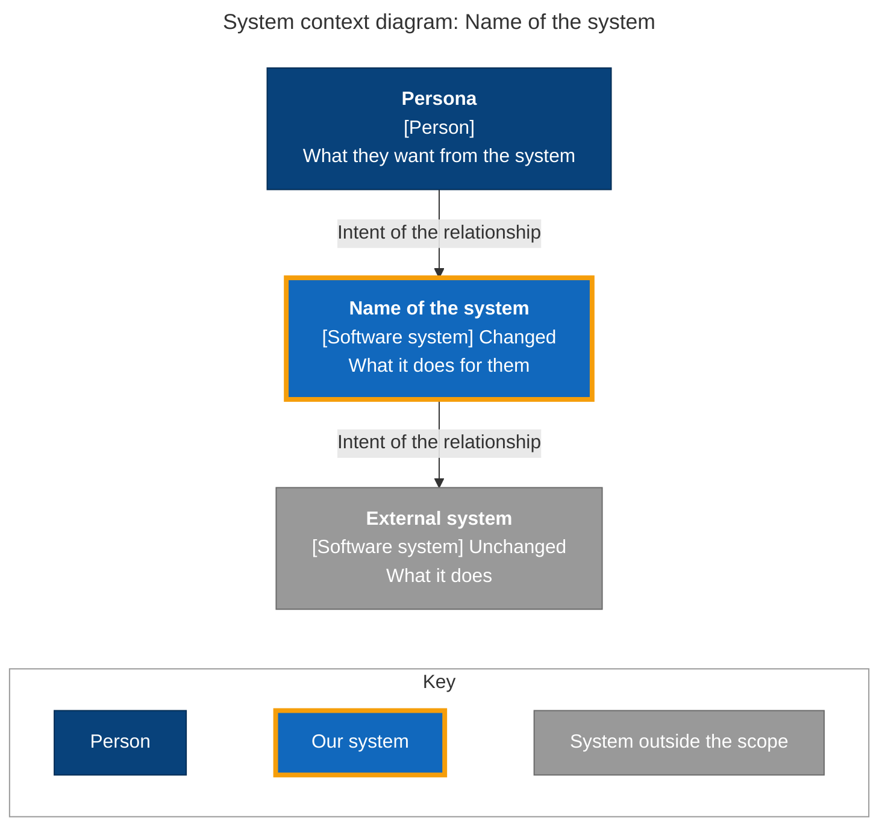
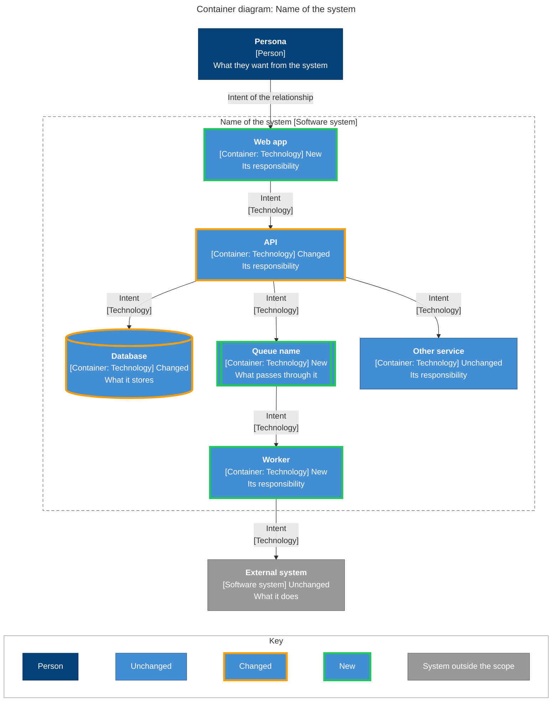
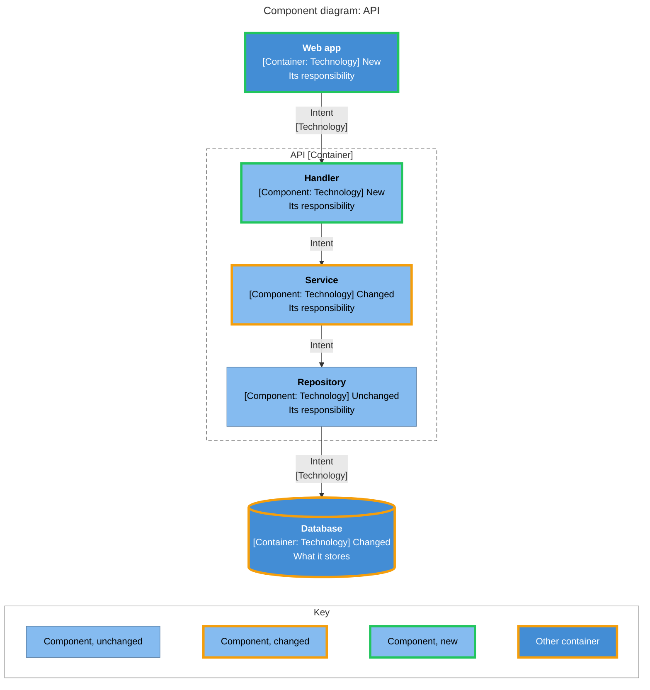
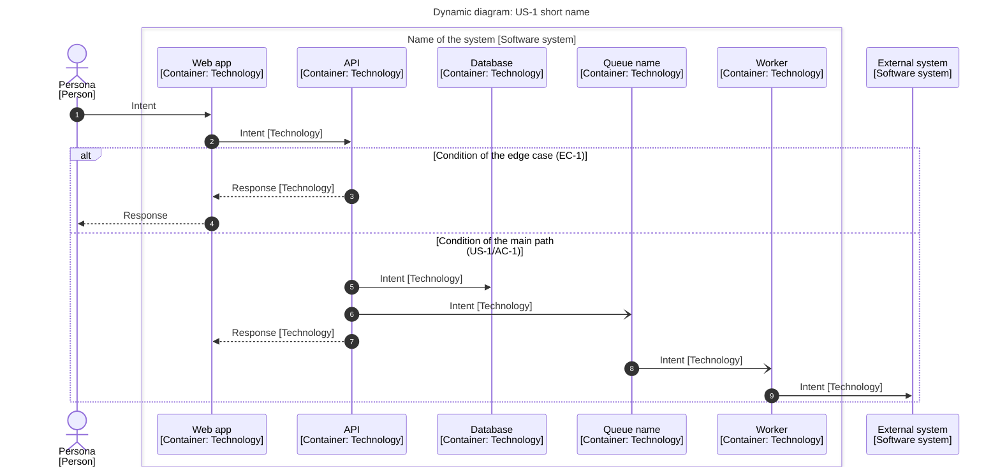
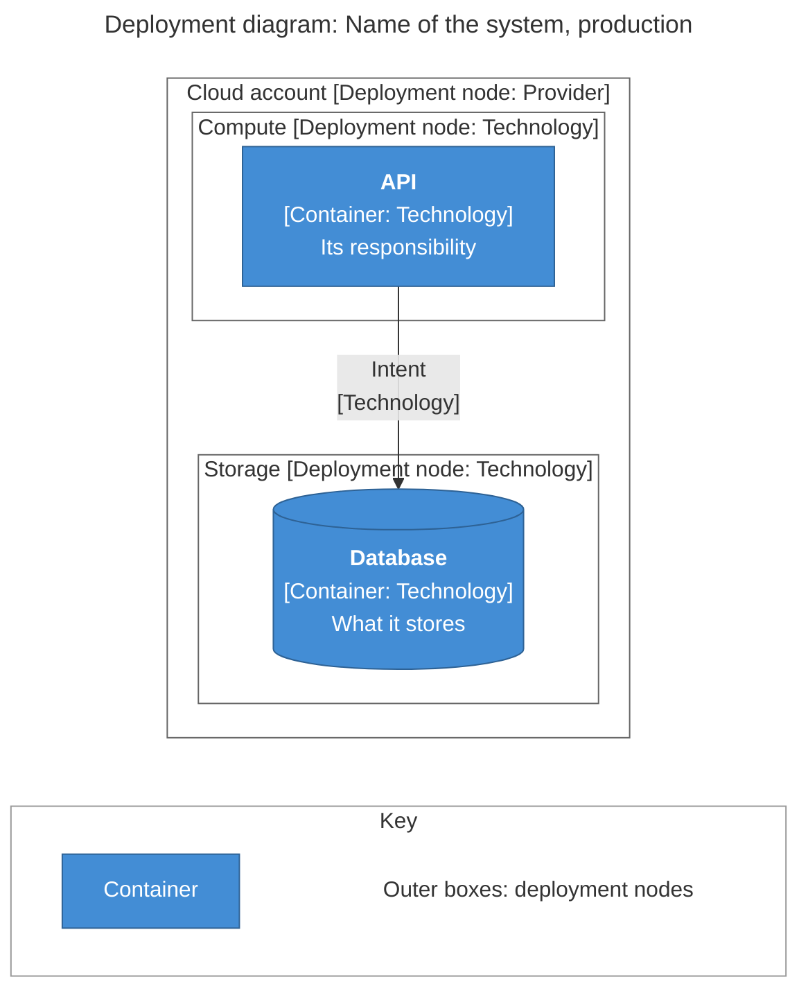

# Design template

Use these sections, in this order. Section guidance is in the HTML comments; remove the comments in the final document. Keep every section so the numbering stays stable. The diagrams are written to render as they are: replace their placeholder names, and remove the elements, classes and key entries that aren't used.

````markdown
---
description: Design for <spec title>
generated:
  at: <ISO 8601 datetime with UTC offset>
  by: <agent>/<version>
id: <spec-id>-design
# When the spec is in the same bundle; mirror it with a body link
links:
  - note: The spec this design delivers
    rel: references
    to: <spec id>
# When the spec is outside the bundle (instead of the link above), and for other sources
sources:
  - id: <short-id>
    resource: <URL or path>
    title: <source title>
status: draft
tags:
  - <tag>
title: "Design: <spec title>"
type: Design
# Added on merge by okf-approve, never by hand:
# verified:
#   - at: <ISO 8601 datetime with UTC offset>
#     by: human:<GitHub login>
---

# Design: <spec title>

## 1. Scope

<!--
Bullets only. Codebase scope: one bullet per repository (with the app or package path in a monorepo), "Not analysed:
<reason>" instead of the branch and commit for a repository left out or not reachable.
Sub-system grain: Container, or the other level used, and why.
Assumptions: only for a spec not written by the specs skill, when the user chose to go on without it; otherwise remove.
-->

- **Spec:** [<spec title>](/<spec-file>.md)
- **Spec type:** <Feature | Bug fix | Refactoring>
- **Sub-system grain:** <Container | Software system | Component>
- **Codebase scope:**
  - <repository>[/<app or package path>] @ <branch> (<short commit>)

## 2. Key

<!--
Applies to the dynamic diagrams, and explains any abbreviation used in the document. The structural diagrams carry their
own key too, so they can be read when they are copied elsewhere.
-->

| Notation | Meaning |
| -------- | ------- |
| Solid arrow, closed head | Synchronous request |
| Solid arrow, open head | Asynchronous message |
| Dashed arrow | Response |
| Numbered circle | Step number, cited by the notes |
| Outer box | Boundary of the software system |
| Colour of a participant | No meaning: set by the renderer |

## 3. System context

<!--
C4 level 1. People and software systems only: no containers. Up to three notes below the diagram, only for what it
can't show. Status in the type line: New, Changed or Unchanged.
-->



## 4. Sub-systems

<!--
C4 level 2: every sub-system involved, including the unchanged ones a workflow goes through. Data stores as cylinders,
each queue or topic as its own container. Arrows: intent, then [technology]; no technology needed for an arrow from a
person. For a refactoring: one diagram for today, one for the target. For rollout phases that change the sub-systems:
one diagram per phase. Notes only for what the diagram can't show, such as the reason for a coupling.
Table: one row per sub-system, named as in the diagram and the code. It indexes the diagram, so it doesn't repeat each
element's responsibility or technology. Status: New | Changed | Unchanged | External.
Location: repository and path, or "New: <where it will live>". Stories: the workflows it takes part in, in section 6.
-->



| Sub-system | Status | Location | Stories |
| ---------- | ------ | -------- | ------- |
| <name> | <status> | <repository>/<path> | <US-1, US-2> |

## 5. Components

<!--
C4 level 3, one diagram per container whose inside decides how a story works, in the same order as the table above.
Arrows to the other containers and systems it deals with are drawn as supporting elements.
If none is needed, write "Not needed: <reason>." instead.
-->



## 6. Workflows

<!--
One sub-section per user story, in the spec's order, each with its own dynamic diagram. Each acceptance criterion and
edge case of the story is visible: alt or opt blocks cite their reference. Participant names and types as in sections
4 and 5. Then edge cases and constraints that belong to no story, when they have a workflow worth showing.
Up to three notes below a diagram, citing step numbers, only for what the diagram can't show.
Bug fix: the actual workflow, then the corrected one. Refactoring: before and after, for workflows that must stay identical.
-->

### US-1: <short name>



- Step 4: <only what the diagram can't show, e.g. why this step comes before the next>

> **Open question:** <only when the user deferred one: what's undecided, and what the diagram assumes>

## 7. Deployment

<!--
C4 deployment diagram, one per environment that differs in a way that matters. Deployment nodes as nested subgraphs,
containers inside them. If none is needed, write "Not needed: <reason>." instead.
-->



## 8. Design decisions

<!--
Strong choices only: costly to reverse, shaping several sub-systems or their contracts, adding a technology, or with
lasting consequences. At least two workable options per choice, one line each: the option, then its main trade-off.
If there are none, write "None: the design follows the codebase's existing patterns."
Decision: the user's decision and its reason, or "Open; the diagrams assume <option>".
For the plan: "ADR" when the choice deserves one, "Feasibility: <what's uncertain>" when it needs testing, or "None".
-->

| Choice | Options and trade-offs | Decision | Shapes | For the plan |
| ------ | ---------------------- | -------- | ------ | ------------ |
| <choice> | <option A: trade-offs, coupling><br/><option B: trade-offs, coupling> | <decision> | <sections or diagrams> | <ADR, Feasibility, None> |

## 9. Coverage

<!--
Every user story, then every other spec item, and the diagram that shows it. Use the spec's IDs, or the conventions of
the tests skill: US-n/AC-m, EC-n, C-n. Where: the workflow and steps, or the diagram and element. A constraint with no
architectural effect is "No effect on the design". An item the design can't reach yet is raised with the user first,
and then marked "Open question".
-->

| Spec item | Summary | Where | Sub-systems |
| --------- | ------- | ----- | ----------- |
| US-1/AC-1 | <short summary> | US-1, steps 1 to 8 | <names> |
| EC-1 | <short summary> | US-1, steps 3 and 4 | <names> |
| C-1 | <short summary> | Section 7, Database | <names> |

<!-- Footnotes: one per cited source, label = sources[].id -->

[^short-id]: <source title>, <URL or path>
````
