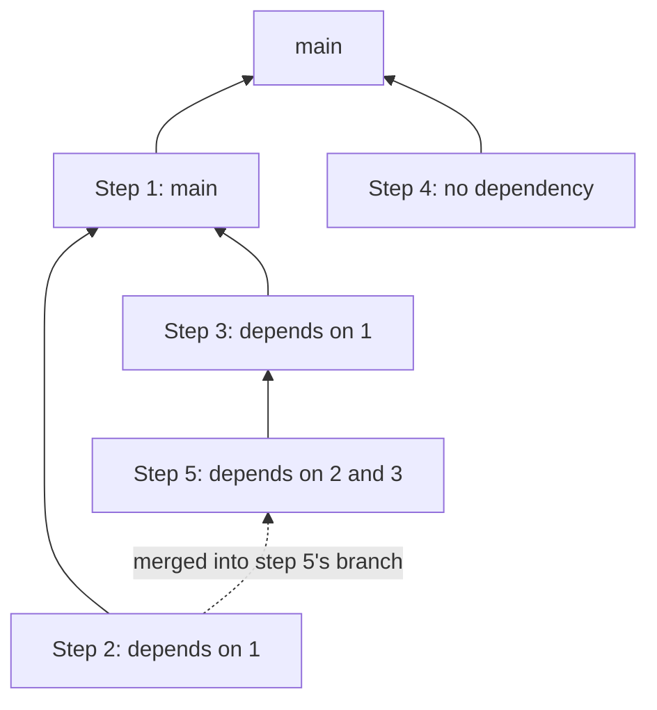

# Implement

Execute one implementation plan: for each of its steps, write the code and its tests, check that the expected tests pass, and open a pull request. The result is a set of pull requests, one per step, arranged to mirror the plan's dependencies and ready for review. Stop there: people review and merge them.

## Rules

- **The plan must be given.** The input is one plan, given as a path to a single markdown file. Don't build one from the conversation, the spec or the code. Without one, or when the file can't be executed (see [Load the plan](#1-load-the-plan)), say why in a few words, suggest the `plan` skill, and stop.
- **Don't ask questions, apart from the two exceptions.** All the answers are supposed to be in the plan. Ask only about [feasibility results and undecided ADRs](#the-two-exceptions). Asking to continue, to confirm a detail or to choose between small options is exactly what this skill must not do. Invoking the skill is the go-ahead for every branch, commit, push and pull request it makes.
- **When the plan has no answer, don't guess past it.** See [When the plan runs out](#when-the-plan-runs-out): decide what's small and reversible and record it, and stop the step for anything else, then carry on with the steps that don't depend on it.
- **One branch and one pull request per step.** Don't combine steps or split them. A step's diff stays within its deliverable and its sub-systems.
- **Never bend the tests.** A step isn't done because its code looks right. It's done when its [expected tests](#tests) were seen to pass. Never skip, disable, weaken or delete a test, or relax a threshold, to get a step through.
- **The spec, the test plan and the plan are read-only.** Follow them, and report any problem found in them. Only an ADR's decision is written, as described below.
- **Stay within what a step permits.** Never merge or approve a pull request, push to the default branch, bypass hooks or checks (e.g. `--no-verify`), deploy, change anything in production, or contact anyone. The only force-push allowed is `--force-with-lease` on a step's own branch, after a [rebase](#4-re-running). Anything that needs one of these is [work for a person](#work-for-a-person).
- **Leave the user's working copy alone.** Work in a separate git worktree for each step, never in a checkout that may hold the user's changes.
- **Follow the repository.** Its agent instructions, contributing guide, code patterns, branch names, commit messages, pull request templates, linters and formatters come before anything here, as long as there's still one branch and pull request per step.
- **Side issues stay out.** A bug or a clean-up you notice goes in the final report, never in a step's diff.

## The two exceptions

Ask the user only in these cases, one question at a time by preference and never more than 3 at a time, using your structured question tool (e.g. `AskUserQuestion` in Claude Code) with the options named. Work that doesn't rest on the answer can go on in the meantime.

**Undecided ADRs, before any code.** Before starting, go through the plan's Technical choices and its ADRs. Ask about a choice when it has no decision: no option chosen, and no step named to settle it. Write the answer into the ADR's Decision (and Consequences, when it changes them), which goes in a [documents pull request](#documents-pull-request). A decision that's already recorded is not a question, even when its ADR is still `status: draft`. Neither is a choice that "the plan assumes … meanwhile": go on with the assumed option until the step that settles it.

**Feasibility results, as they come.** Feasibility steps run first (see [Feasibility steps](#feasibility-steps)). Then, for each result:

| Result | What to do |
| --- | --- |
| A clean pass, and it confirms what the plan assumes | Go on without asking. Write any ADR the step calls for, with the assumed option as its decision. |
| A pass, but it points to another option than the plan assumes | Ask which option to take, as an ADR decision. |
| A fail, or no answer within the effort limit | Ask, with the plan's **On failure** as the recommended option. |

When the answer changes the steps that rest on the result, those steps can't be executed as written: stop them, say that the plan needs updating with the `plan` skill, and carry on with the steps that aren't affected. When the plan is updated, a [re-run](#4-re-running) picks up from there.

Any other doubt, including one about a choice or a feasibility result that's been settled, is handled under [When the plan runs out](#when-the-plan-runs-out).

## Pull request layout

The plan's **Depends on** lists decide the layout. Step numbers give an order, not a sequence: two steps with no dependency between them are never stacked.

A step's base is worked out from its code dependencies, leaving out those already merged, and any that another listed dependency already contains:

| Unmerged code dependencies | Branch from, and pull request base | Result |
| --- | --- | --- |
| None | The default branch (or the base the plan names) | A separate pull request, next to its siblings |
| One | That dependency's branch | Stacked on it: sequential pull requests |
| Several | The highest-numbered one's branch, with the others merged into the new branch | Stacked on it, and containing the others |

Here, steps 2 and 3 are siblings on step 1, step 4 is a sibling of step 1 on `main`, and step 5 is stacked on step 3 with step 2 merged in.

- **Several dependencies.** The diff of such a pull request also shows the other dependencies until they're merged. Its description says so, and names them under **Merge after**. If they conflict, resolve the conflict when it's mechanical; otherwise the step stops (see [When the plan runs out](#when-the-plan-runs-out)), since the plan took them to be independent.
- **Merge order.** Every pull request's description names what it stacks on and what must be merged first, and what stacks on it. Add the links as the later pull requests are opened.
- **Branch names.** Unless the repository has its own convention, use `<prefix>/<spec-slug>-step-<n>-<slug>`, where `<prefix>` is `feat`, `fix` or `refactor` for the spec's type, and `<spec-slug>` is the spec's `id` without its type (e.g. `invoice-line` for `feature-invoice-line`). These names let a re-run find the work done so far.
- **Several repositories.** A pull request can't stack across repositories. A step in one repository that depends on a step in another branches from its own default branch, and links the other pull request under **Merge after**. If its tests can't run until that one is merged, the step stays a draft, with those tests left unchecked. A step spanning two repositories has one branch and pull request in each, linked to each other.

### Feasibility steps

A feasibility step gets its own branch (`spike/<spec-slug>-step-<n>-<slug>`, from the default branch) and a pull request that stays a draft, titled `[feasibility, do not merge]`. It holds the throwaway code and the repeatable run, and its description gives the question, the run, the result and the answer. Close it only if the user asks.

Later steps depend on its answer, not on its code. So a dependency on a feasibility step never decides a base, and never stacks: it only means the step waits for a clean result.

Run the test the step describes, as written, in the environment it describes. If that environment isn't available, the result is "no answer": never substitute a smaller test and call it a pass. An effort limit in developer-days is a rough size: stop once the described test has been made to run and any fault in the experiment fixed, instead of iterating for a better number.

### Documents pull request

ADRs that get written or decided go in a separate pull request from the default branch, `docs/<spec-slug>-adrs`, whose base is the default branch. No step stacks on it. ADRs keep their `status: draft` and follow the [publishing flow of the specs skill](../specs/SKILL.md#publishing), without its go-ahead: the invocation gave it.

## Tests

**A step's expected tests are:**

- the tests assigned to it in the plan (**Tests to pass**, and the same step in the Coverage section);
- the tests of every step it contains, through its base and its merged dependencies;
- the regression suites listed for it;
- its **Verification** checks, if any;
- the repository's own checks that apply to the change (build, types, linter).

Tests assigned to other steps may fail or be missing, and aren't expected yet.

**For each step:**

1. **Get a baseline.** Run the expected existing tests in the fresh worktree, before changing anything. What already fails there isn't the step's fault: leave it alone, and report it.
2. **Write the step's tests first,** unless they already exist, exactly as the test plan describes them (subject, setup, action, expected result, test doubles), and see them fail for the right reason. Put the test's ID in its name or a tag when the framework allows it, so that the pull request's checklist maps to real tests.
3. **Implement** until they pass, following the step's **Changes**.
4. **Run all the expected tests,** not just the new ones, and read the result. Each one that was seen to pass gets its box checked in the pull request. Nothing else does.
5. **Check CI** once the pull request is open, waiting for it to finish (e.g. `gh pr checks --watch`), and fix what fails. Workflows often run only on pull requests to the default branch, so a stacked pull request may trigger none: say so in its description, and rely on the local run until it's retargeted. Don't change a workflow to get around this.

A flaky failure gets one re-run, and is reported. A test that can't be run here (e.g. it needs a staging environment or a device) stays unchecked with the reason, which makes the step **Needs checking**.

## When the plan runs out

The plan can't foresee everything, and the code may have moved on since it was written. Without asking:

**Decide and record it** when the decision is small and reversible, stays inside the step's deliverable and sub-systems, and follows the plan, the spec and the codebase's patterns. Examples: a name, a file's location, a helper, or a component that was renamed since the plan was written. List it under **Decisions made** in the pull request, so that reviewers can challenge it.

**Stop the step** when going on would need any of these:

- changing what the spec, the test plan or an ADR says, or doing something they rule out;
- a strong technical choice the plan doesn't make;
- changing a test, or a test that can't pass as written;
- a sub-system the step doesn't list;
- a code dependency that isn't in the step's **Depends on**;
- a step marked **Blocked**, or one with an open question that its work relies on;
- no progress after three different attempts to get the tests or CI to pass.

**A stopped step** keeps what's useful on its branch, in a pull request that stays a draft, and its description says exactly what stopped it and what the plan would need to say. A step marked **Blocked** with nothing done gets no branch. Steps that depend on it, directly or not, aren't started. Every other step goes on. Report them all at the end.

### Work for a person

Some steps can't be finished by an agent: a release slot to agree, an account to create, a production rollout, an exit criterion measured in production. Do any part of it that lives in the repository (e.g. a flag's configuration), as an ordinary pull request. For the rest, the step is **Needs a person**, its dependents don't start, and the report says who has to do what, as far as the plan says.

## Process

### 1. Load the plan

1. Read the whole plan, then the spec, the test plan and the ADRs it references, and each repository's agent instructions. Read what's needed of the code at each step, using a code index such as CodeGraph first, when you have one and the repository is indexed.
2. Check that it can be executed. It needs ordered steps with deliverables, and a way to check each one. A plan not written by the `plan` skill can do: where it has no dependencies, take each step to depend on the one before it, which is always safe, and say so in the report. If it has no such steps, stop.
3. Check that it's approved: `status: stable`, or its pull request merged. If it isn't, stop and report it, unless the user's request says to go ahead with a draft. Do the same when the spec or the test plan has changed since the plan was written (a later `generated` date or a changed `status`), since the plan may be out of date.
4. Check that every repository in the plan's codebase scope is reachable, with a local working copy you can make worktrees from and a remote you can push to, and that you can open pull requests. If not, stop and report it.
5. Check the plan's Prerequisites where you can. An unmet one stops the whole run, with a report. One that can't be checked is noted in the report, and the run goes on.
6. Look for work from an earlier run (see [Re-running](#4-re-running)).

### 2. Settle the exceptions

1. Ask about [undecided ADRs](#the-two-exceptions).
2. Run the feasibility steps, in parallel when they're independent, and open their pull requests.
3. Act on the results as described under [The two exceptions](#the-two-exceptions). From here on, there are no more questions, unless a step that settles a choice comes later in the plan.

### 3. Execute the steps

Work through the steps in dependency order, lowest number first. A step is ready when each of its dependencies is done: a code dependency has its pull request open with its tests checked and its CI finished, and a feasibility dependency has a clean result.

When several steps are ready, run them at the same time if your agent can (e.g. sub-agents, each with its own worktree, given the step, the rules and the branch to start from), and otherwise one after the other. Sub-agents don't ask questions either: they report a stopped step back.

For each step:

1. **Create the worktree and branch** from the base given by the [layout](#pull-request-layout), and merge in any other dependencies.
2. **Do the work,** following [Tests](#tests) and the step's **Changes**. Commit in small, clear commits, in the repository's style.
3. **Check the diff:** nothing outside the step's deliverable and sub-systems, nothing unrelated, no debug code, no secrets.
4. **Push, and open the pull request** as a draft, with the base from the layout and the description from [template.md](template.md). Its title follows the repository's convention, and names the step.
5. **Check CI,** and fix what fails.
6. **Update the checklist,** and mark the pull request ready for review if every expected test is checked and CI is green or not triggered. Otherwise, it stays a draft (**Needs checking** or **Stopped**).
7. **Link it** from the pull requests it stacks on.

When a phase ends, run its exit check where you can, and add the result to the report.

**At the end,** when the last steps are in side-by-side pull requests, merge them into a local throwaway branch, run the whole test plan on it, and report the result. Don't push that branch. This shows whether the plan's constraint holds once everything is together, which no single pull request can show. When a single stack holds everything, its last pull request already showed this.

Then remove the worktrees you created, keeping the branches, and give the [run report](template.md) as your final reply.

### 4. Re-running

Running the skill again on the same plan continues the work and brings it up to date: nothing in it relies on this conversation. Find each step's branch and pull request by name (e.g. `gh pr list --state all --head <branch>`):

- **Merged:** the step is done. A stacked pull request whose base was merged is retargeted to the default branch, and its branch is rebased onto it (`git rebase --onto <new base> <old parent tip>`), which also clears a squash merge's duplicate commits.
- **Open, with a base that has moved:** rebase it onto its base, push with `--force-with-lease`, and check the expected tests again.
- **Open and complete:** leave it alone. Don't act on review comments unless the user's request says to; list the pull requests with changes requested in the report.
- **Stopped or unfinished:** try it again from where it stands, with the current plan.
- **Closed without merging:** report it, and don't reopen or recreate it. Its dependents don't start.
- **Missing:** start it when it's ready.

## Quality checklist

Before giving the report, check that:

- [ ] Every step in the plan has a status in the report.
- [ ] Each step that was started has its own branch and pull request; no step shares one.
- [ ] Each pull request's base follows the layout: stacked on its unmerged dependencies, side by side otherwise.
- [ ] Each pull request's description names what it stacks on, what it must be merged after, and what stacks on it.
- [ ] Each pull request's expected tests are listed by ID; only those seen to pass are checked, and the command run is stated.
- [ ] No pull request was marked ready with an unchecked expected test or a red CI.
- [ ] No test was skipped, weakened or deleted, and no threshold relaxed.
- [ ] Questions were asked only about feasibility results and undecided ADRs.
- [ ] Every decision taken without the plan is listed in its pull request.
- [ ] Nothing was merged or approved, and nothing was pushed to the default branch.
- [ ] The spec, the test plan and the plan are unchanged.
- [ ] The whole test plan was run with all the work together, or the report says why it couldn't be.
