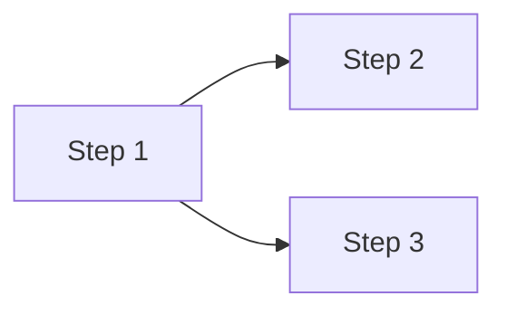

# Implementation plan template

Use these sections, in this order. Section guidance is in the HTML comments; remove the comments in the final document. Keep every section so the numbering stays stable.

````markdown
---
description: Implementation plan for <spec title>
generated:
  at: <ISO 8601 datetime with UTC offset>
  by: <agent>/<version>
id: <spec-id>-plan
# When the spec, the test plan and the ADRs are in the same bundle; mirror each one with a body link
links:
  - note: <the decision the ADR records>
    rel: references
    to: <ADR id>
  - note: The spec this plan implements
    rel: references
    to: <spec id>
  - note: The test plan whose tests this plan must make pass
    rel: references
    to: <test plan id>
# When any of those is outside the bundle (instead of the links above), and for other sources
sources:
  - id: <short-id>
    resource: <URL or path>
    title: <source title>
status: draft
tags:
  - <tag>
title: "Implementation plan: <spec title>"
type: Implementation plan
# Added on merge by okf-approve, never by hand:
# verified:
#   - at: <ISO 8601 datetime with UTC offset>
#     by: human:<GitHub login>
---

# Implementation plan: <spec title>

## 1. Scope

<!--
The spec, its type, what the plan delivers in one or two sentences, the test plan, and the codebase scope: one bullet
per repository (with the app or package path in a monorepo), "Not analysed: <reason>" instead of the branch and commit
for a repository left out or not reachable.
Constraint with a test plan: "All the tests in the test plan pass at the end of the last step."
Without one: Test plan "None", and Constraint "Every step's Verification passes."
-->

- **Spec:** [<spec title>](/<spec-file>.md)
- **Spec type:** <Feature | Bug fix | Refactoring>
- **Delivers:** <one or two sentences>
- **Test plan:** [<test plan title>](/<test-plan-file>.md)
- **Constraint:** All the tests in the test plan pass at the end of the last step.
- **Codebase scope:**
  - <repository>[/<app or package path>] @ <branch> (<short commit>)

## 2. Hard problems

<!--
The spec's hard technical problem areas, above all those whose feasibility is uncertain, confirmed with the user.
Settled by: "Planning" with the answer and its source, or the step that settles it (a feasibility step or a first slice).
If there are none, write "None found:" and what was looked at, instead of the table.
-->

| Problem | What's uncertain | Spec items | Settled by |
| ------- | ---------------- | ---------- | ---------- |
| <problem> | <what might not work, or isn't known> | <C-1, US-2/AC-1> | <Step 1, or "Planning: answer (source)"> |

## 3. Technical choices

<!--
One sub-section per strong choice: costly to reverse, shaping several sub-systems or their contracts, adding a
technology or dependency, or with lasting consequences. At least two workable options. Not routine choices that simply
follow the codebase's patterns. If there are none, write "None: the plan follows the codebase's existing patterns."
Decision: the user's decision and its reason, or "Settled by step <n>; the plan assumes <option> meanwhile".
ADR: a link to it, or "Not needed: <reason>".
-->

### <Choice>

| Option | Trade-offs | Coupling it creates |
| ------ | ---------- | ------------------- |
| <option A> | <pros and cons against the spec's constraints> | <dependencies between sub-systems, or "None"> |
| <option B> | <pros and cons> | <dependencies, or "None"> |

- **Decision:** <option and reason>
- **ADR:** [<ADR title>](/adr/<adr-file>.md)

## 4. Sub-systems

<!--
The sub-systems the plan touches, named as in the code, as confirmed with the user. Steps refer to them by these names.
-->

| Sub-system | Location | Role in this work |
| ---------- | -------- | ------------------ |
| <name> | <repository>/<path> | <what changes in it, or that it is new> |

## 5. Prerequisites

<!--
What must be true before step 1 starts, and how it was checked. Anything needed later or to be done by the team is a
step of its own, not an entry here. "None" when nothing is required.
-->

- <condition>: <met (how it was checked) | not met (who settles it)>

## 6. Overview

<!--
Phases: the spec's phases, unchanged, with their number and name; Phase 0 for feasibility steps; sub-phases (2.1) or
the plan's own phases. "Origin" says which: Spec, Plan or Feasibility. Each outcome is significant progress, ideally
the implementation of the spec within one sub-system, and can be verified. For a plan with one obvious outcome, replace
the table with "Single phase." and remove the Phase column from the steps table and the phase headings in section 8.
Steps: numbered through the whole plan. Depends on: lower-numbered steps only, and only those really needed, or "None"
for no dependency beyond the Prerequisites.
Tests: the test IDs assigned to the step; rename the column "Verification" and summarize when there is no test plan.
Diagram: only when the dependencies are not a simple sequence.
-->

| Phase | Origin | Outcome | Steps | Depends on | Exit check |
| ----- | ------ | ------- | ----- | ---------- | ---------- |
| 0: Feasibility | Feasibility | <what we now know> | 1 | None | <result of the feasibility steps> |
| 1: <name> | Spec | <what's true at the end> | 2–4 | 0 | <spec's exit criteria, tests> |
| 1.1: <name> | Plan | <what's true at the end> | 2–3 | 0 | <tests> |

| Step | Phase | Deliverable | Depends on | Sub-systems | Tests |
| ---- | ----- | ----------- | ---------- | ----------- | ----- |
| 1 | 0 | <the answer to a feasibility question> | None | <name> | None: feasibility |
| 2 | 1.1 | <what works afterwards> | 1 | <name> | UT-1, IT-1 |



## 7. Independence

<!--
How far the work can be dispatched among developers working independently.
Sub-system pairs: every pair of impacted sub-systems; Relation is Independent, Through a contract, or Sequenced.
Reason: why the dependency is needed; "None" for Independent.
Cycles: in the work and in the design, how each was broken, or the agreed reason it stays.
Workstreams: what a single developer could take on. Waits for: steps in other workstreams. Meets at: the step or
phase where it comes together with another. For one stream of work, write "One workstream: <why>." instead of the table.
-->

| Sub-systems | Relation | Contract or dependency | Reason |
| ----------- | -------- | ---------------------- | ------ |
| <A>, <B> | Through a contract | <API, event or schema, defined in step n> | <why they need each other> |

**Cycles:** <"None, in the work or the design", or each cycle and how it's handled>

| Workstream | Sub-systems | Steps | Waits for | Meets at |
| ---------- | ----------- | ----- | --------- | -------- |
| <name> | <names> | 2, 3 | <step 1, or "Nothing"> | <step n> |

## 8. Steps

<!--
One sub-section per phase, and one per step inside it, numbered as in the overview. An outline, not instructions:
no code, diffs or line numbers.
Add "Scope exception" only for a step that touches more than two sub-systems, with the reason the user agreed to.
Mark a step **Blocked** next to its title when an open question stops it, with the question inline.
-->

### Phase 0: Feasibility

#### Step 1: <question in a few words>

- **Deliverable:** The answer to "<question>", with a run that can be repeated.
- **Depends on:** None
- **Sub-systems:** <names, as used by the experiment>
- **Test:** <how it's tested, on what data or at what load>
- **Pass or fail:** <the result that answers the question>
- **Effort limit:** <agreed limit; past it, the question is treated as unanswered>
- **On failure:** <the fallback option, or back to the user to change the approach or the spec>
- **Then:** The plan is reviewed before step <n> starts; <ADR to write, if any>

### Phase 1: <name>

**Outcome:** <what's true at the end of this phase>

#### Step 2: <name>

- **Deliverable:** <the functionality that works after this step, in one or two sentences>
- **Depends on:** <lower-numbered steps, or "None">
- **Sub-systems:** <one or two names from section 4>
- **Changes:**
  - <component as named in the code, or "new: <name>">: <what changes in it>
- **Tests to pass:** <test IDs assigned to this step, and whether the step writes them or they already exist; then "and those of steps <n>…"; regression suites to re-run>
- **Verification:** <only without a test plan, or for a check the test plan doesn't need: the check, its expected result, and the spec item it comes from>
- **Delivers spec items:** <US-1/AC-1, EC-2>

> **Open question:** <only when the user deferred one, with the tests it blocks>

## 9. Coverage

<!--
Every spec item and the step that delivers it. Status: Planned | Blocked (open question) | Outside the plan (agreed
reason, e.g. a rollout exit criterion measured in production after the last step). Use the same references as the test
plan when there is one. Remove the Tests column when there is no test plan.
Every test in the test plan appears exactly once in the Tests column or in the table below.
-->

| Spec item | Summary | Step | Tests | Status |
| --------- | ------- | ---- | ----- | ------ |
| US-1/AC-1 | <short summary> | 2 | AT-1, UT-1 | Planned |

<!-- Tests from the test plan that aren't tied to one spec item above, such as regression suites. Remove if none. -->

| Test | Step |
| ---- | ---- |
| <suite or test ID> | <step> |

<!-- Footnotes: one per cited source, label = sources[].id -->

[^short-id]: <source title>, <URL or path>
````
