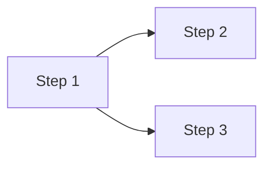

# Implementation plan template

Use these sections, in this order. Section guidance is in the HTML comments; remove the comments in the final document.

````markdown
---
description: Implementation plan for <spec title>
generated:
  at: <ISO 8601 datetime with UTC offset>
  by: <agent>/<version>
id: <spec-id>-plan
# When the spec and the test plan are in the same bundle; mirror each one with a body link in section 1
links:
  - note: The spec this plan implements
    rel: references
    to: <spec id>
  - note: The test plan whose tests this plan must make pass
    rel: references
    to: <test plan id>
# When the spec or the test plan is outside the bundle (instead of the links above), and for other sources
sources:
  - id: <short-id>
    resource: <URL or path>
    title: <source title>
status: draft
tags:
  - <tag>
title: "Implementation plan: <spec title>"
type: Implementation plan
# Added on merge by okf-approve, never by hand:
# verified:
#   - at: <ISO 8601 datetime with UTC offset>
#     by: human:<GitHub login>
---

# Implementation plan: <spec title>

## 1. Scope

<!--
The spec, its type, what the plan delivers in one or two sentences, the test plan, and the codebase scope: one bullet
per repository (with the app or package path in a monorepo), "Not analysed: <reason>" instead of the branch and commit
for a repository left out or not reachable.
Constraint with a test plan: "All the tests in the test plan pass at the end of the last step."
Without one: Test plan "None", and Constraint "Every step's Verification passes."
-->

- **Spec:** [<spec title>](/<spec-file>.md)
- **Spec type:** <Feature | Bug fix | Refactoring>
- **Delivers:** <one or two sentences>
- **Test plan:** [<test plan title>](/<test-plan-file>.md)
- **Constraint:** All the tests in the test plan pass at the end of the last step.
- **Codebase scope:**
  - <repository>[/<app or package path>] @ <branch> (<short commit>)

## 2. Approach

<!--
The technical decisions the spec leaves open, validated by the user, each with its reason and the options set aside.
Only real decisions: nothing that simply follows the codebase's existing patterns. "None" if there are no such decisions.
-->

| Decision | Reason | Options set aside |
| -------- | ------ | ----------------- |
| <decision> | <why> | <alternative: why not, or "None"> |

## 3. Sub-systems

<!--
The sub-systems the plan touches, named as in the code, as confirmed with the user. Steps refer to them by these names.
-->

| Sub-system | Location | Role in this work |
| ---------- | -------- | ------------------ |
| <name> | <repository>/<path> | <what changes in it, or that it is new> |

## 4. Prerequisites

<!--
What must be true before step 1 starts, and how it was checked. Anything needed later or to be done by the team is a
step of its own, not an entry here. "None" when nothing is required.
-->

- <condition>: <met (how it was checked) | not met (who settles it)>

## 5. Overview

<!--
One row per step, in order. Depends on: lower-numbered steps only, or "None" for no dependency beyond the Prerequisites.
Use only the steps a step really needs, so that a reader can see which ones could run in parallel.
Phase: the spec's Rollout phase the step belongs to; remove the column for a single phase.
Tests: the test IDs assigned to the step; rename the column "Verification" and summarize when there is no test plan.
-->

| Step | Deliverable | Depends on | Sub-systems | Phase | Tests |
| ---- | ----------- | ---------- | ----------- | ----- | ----- |
| 1 | <what works afterwards> | None | <name> | 1 | UT-1, IT-1 |
| 2 | <what works afterwards> | 1 | <name>, <name> | 1 | CT-1, AT-1 |

<!-- Only when the dependencies are not a simple sequence -->



## 6. Steps

<!--
One sub-section per step, numbered as in the overview. An outline, not instructions: no code, diffs or line numbers.
Add "Scope exception" only for a step that touches more than two sub-systems, with the reason the user agreed to.
Mark a step **Blocked** next to its title when an open question stops it, with the question inline.
-->

### Step 1: <name>

- **Deliverable:** <the functionality that works after this step, in one or two sentences>
- **Depends on:** <previous steps, or "None">
- **Sub-systems:** <one or two names from section 3>
- **Changes:**
  - <component as named in the code, or "new: <name>">: <what changes in it>
- **Tests to pass:** <test IDs assigned to this step, and whether the step writes them or they already exist; then "and those of steps <n>…"; regression suites to re-run>
- **Verification:** <only without a test plan, or for a check the test plan doesn't need: the check, its expected result, and the spec item it comes from>
- **Delivers spec items:** <US-1/AC-1, EC-2>

> **Open question:** <only when the user deferred one, with the tests it blocks>

### Step 2: <name>

- **Deliverable:** <the functionality that works after this step>
- **Depends on:** 1
- **Sub-systems:** <names>
- **Changes:**
  - <component>: <what changes in it>
- **Tests to pass:** <test IDs, and those of step 1>
- **Delivers spec items:** <items>

## 7. Coverage

<!--
Every spec item and the step that delivers it. Status: Planned | Blocked (open question) | Outside the plan (agreed
reason, e.g. a rollout exit criterion measured in production after the last step). Use the same references as the test
plan when there is one. Remove the Tests column when there is no test plan.
Every test in the test plan appears exactly once in the Tests column or in the table below.
-->

| Spec item | Summary | Step | Tests | Status |
| --------- | ------- | ---- | ----- | ------ |
| US-1/AC-1 | <short summary> | 2 | AT-1, UT-1 | Planned |

<!-- Tests from the test plan that aren't tied to one spec item above, such as regression suites. Remove if none. -->

| Test | Step |
| ---- | ---- |
| <suite or test ID> | <step> |

<!-- Footnotes: one per cited source, label = sources[].id -->

[^short-id]: <source title>, <URL or path>
````
