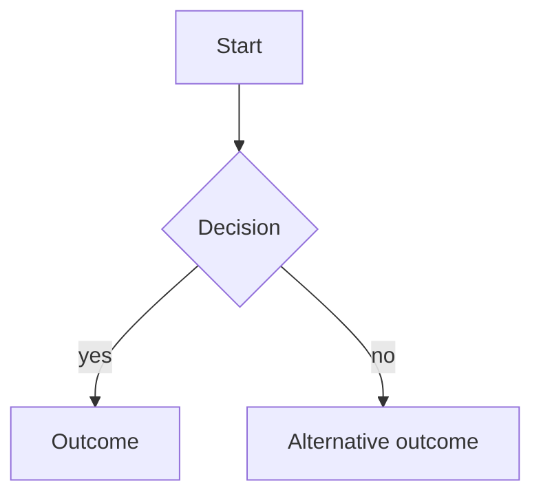

# Spec template

Use these sections, in this order. Section guidance is in the HTML comments; remove the comments in the final document.

````markdown
---
description: <one-line summary of the intent>
generated:
  at: <ISO 8601 datetime with UTC offset>
  by: <agent>/<version>
id: <type>-<slug>
# Only when related specs exist; mirror each one with a body link
links:
  - note: <why they are related>
    rel: <depends-on | references | relates-to | supersedes>
    to: <target spec id>
sources:
  - id: <short-id>
    resource: <URL or path>
    title: <source title>
status: draft
tags:
  - <tag>
title: <Title>
type: <Feature | Bug fix | Refactoring>
# Added on merge by okf-approve, never by hand:
# verified:
#   - at: <ISO 8601 datetime with UTC offset>
#     by: human:<GitHub login>
---

# <Title>

## 1. Intent

<!-- One to three sentences: the purpose of this work and the outcome it delivers. -->

## 2. Type

<!-- Exactly one of: Feature | Bug fix | Refactoring -->

## 3. Context

<!--
Background a newcomer needs to understand why this matters.
- Feature: the pain points it resolves, how users cope today, links to similar features in other apps, screenshots, mockups.
- Bug fix: steps to reproduce (numbered), expected behaviour, actual behaviour, environment, frequency/severity, logs or screenshots, known workarounds.
- Refactoring: the code-quality pain, the affected modules, why now.
Related specs: one plain link per `links` entry, e.g. "Depends on [<title>](/<target-file>.md)."
-->

## 4. Personas

<!--
Everyone impacted, and how. Most impacts should be gains, but state losses honestly.
-->

| Persona | Impact | Gains | Losses |
| ------- | ------ | ----- | ------ |
| <name>  | Positive / Negative / Mixed | <concrete gain> | <concrete loss, or "None"> |

## 5. Constraints

<!--
Hard requirements that must be met; each one verifiable.
Examples: "No new feature", "Public API unchanged", "Response time ≤ 200 ms at p95", "Must work offline", "No database migration".
-->

- <constraint>

## 6. Boundaries

<!--
What is explicitly not included / out of scope, including related ideas the user chose to defer.
-->

- <out-of-scope item>

## 7. Edge cases

<!--
Unusual, boundary and failure situations, and the expected behaviour for each: empty, missing or invalid input,
limits and volumes, concurrency, permissions, partial failures, timeouts, offline, backwards compatibility.
Every expected behaviour must be verifiable.
-->

| Edge case | Expected behaviour |
| --------- | ------------------ |
| <situation> | <what must happen> |

## 8. User stories

<!--
One story per need, written for a persona from section 4, each with acceptance criteria in Given / When / Then form.
Reference formal requirement IDs when the story derives from one.
- Feature: the stories the feature delivers.
- Bug fix: the story the bug breaks, with acceptance criteria describing the expected (fixed) behaviour.
- Refactoring: maintainer / developer stories; end-user behaviour stays unchanged.
-->

### US-1: <short name>

As a <persona>, I want <capability>, so that <benefit>.

**Acceptance criteria:**

- **Given** <context>, **when** <action>, **then** <outcome>.

## 9. Rollout

<!--
How the change reaches users or production. Single phase: describe it directly, without sub-sections.
Multiple phases: one sub-section per phase, in delivery order. For each phase: what it delivers, who gets it
(all users, a cohort, behind a feature flag, internal only), and the exit criteria to move on to the next phase.
-->

### Phase 1: <name>

- **Delivers:** <scope of this phase>
- **Audience:** <who gets it, and how it is switched on>
- **Exit criteria:** <verifiable condition to move to the next phase>

### Phase 2: <name>

- **Delivers:** <scope of this phase>
- **Audience:** <who gets it, and how it is switched on>
- **Exit criteria:** <verifiable condition to finish the rollout>

## 10. Prerequisites

<!--
What must be true or done before work on a phase can start: other specs delivered (also listed in `links` as
`depends-on`), infrastructure, access and credentials, data migrations, decisions, third-party agreements.
Single phase: a plain list. Multiple phases: one sub-section per phase, matching the Rollout phases.
Write "None" when nothing is required for a phase.
-->

### Phase 1: <name>

- <prerequisite, or "None">

### Phase 2: <name>

- <prerequisite, or "None">

## 11. User journey

<!--
Title this section "User journey" when a user is involved, "Workflow" otherwise.
Diagrams as much as words (Mermaid). Typical choices:
- Feature: the new journey as a flowchart or sequence diagram, including error and edge paths.
- Bug fix: the actual (broken) journey vs the expected journey.
- Refactoring: the workflow / component interactions before vs after (behaviour identical).
Add short notes only where the diagram needs explaining.
-->



## 12. Blast radius

<!--
For existing systems: the components likely to be impacted, and in what way.
Components: modules, packages, services, APIs, database tables, config, jobs, integrations, docs, tests.
Impact kinds: modified, extended, replaced, removed, behaviour change, contract change (API, schema, events), migration needed, retest only.
Name components as they appear in the code (paths, package names), and add a diagram when the dependencies are not obvious.
For a new system with nothing existing to impact, write "Not applicable: new system." instead of the table.
Codebase scope: one bullet per repository (with the app or package path in a monorepo), even for a new system;
"Not analysed: <reason>" instead of the branch and commit for a repository left out or not reachable.
-->

**Codebase scope:**

- <repository>[/<app or package path>] @ <branch> (<short commit>)

| Component | Impact | Details |
| --------- | ------ | ------- |
| <path or name> | <impact kind> | <what changes and why> |

<!-- Footnotes: one per cited source, label = sources[].id -->

[^short-id]: <source title>, <URL or path>
````
